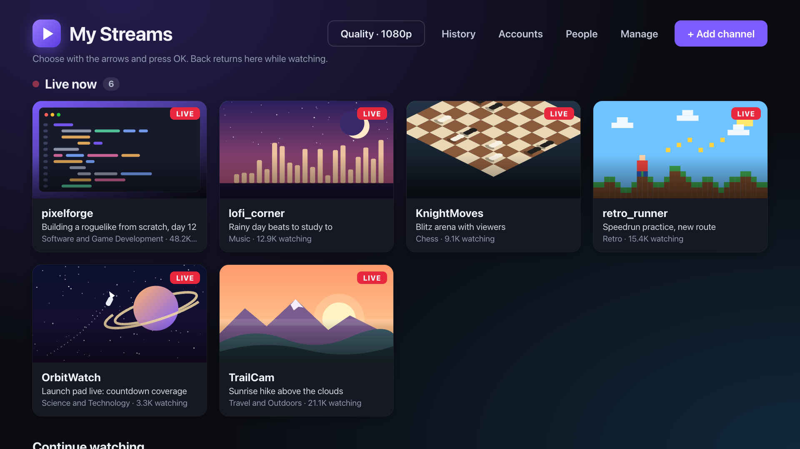
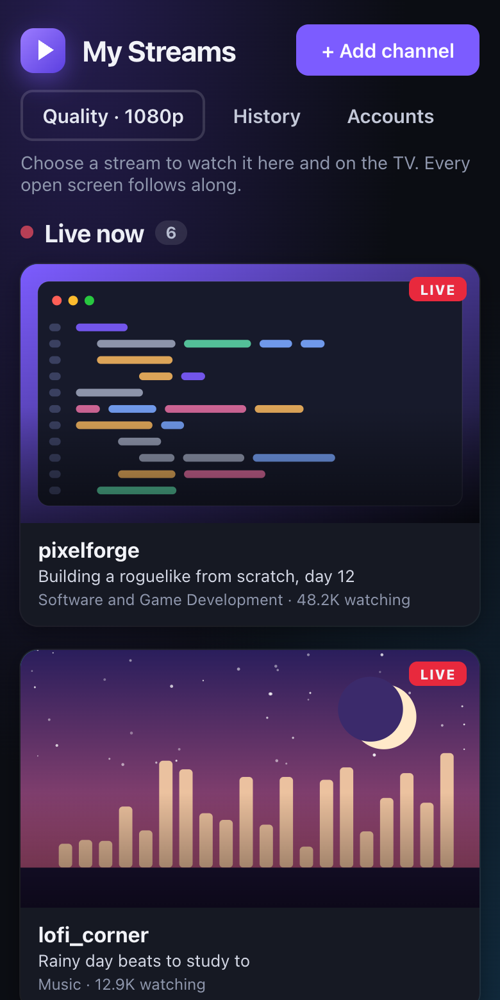
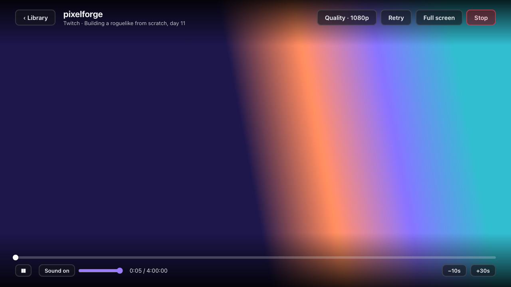

# My Streams

Twitch on an old LG TV.



My LG B7 is from 2017. There is no Twitch app for it any more, and its browser
is too old for twitch.tv itself. So now it has its own app.

There are two parts. A small app on the TV, and a small server on a computer at
home. The server fetches the stream from Twitch and turns it into video the TV
can play. The same library also opens on a phone and a laptop.

I have only run it on my own TV (LG B7, webOS 3.5). Other LG TVs from those
years will probably work. If you try one, tell me how it went.

## What you need

- A computer at home that stays on while you watch. I use a Linux box. It needs
  Python 3.11 or newer.
- Node.js, once, to put the app on the TV.
- LG's free **Developer Mode** app on the TV. No rooting.

## Install

### The easy way: let your AI agent do it

Open Claude Code, Codex or whatever agent you use, on the computer that will
run the server, and paste this:

```
Clone https://github.com/aleksandar3mkd/webos-twitch-relay and install it for me by
following AGENTS.md in the repository. Ask me whenever you need something
from the TV.
```

The agent does the typing. Three things are still yours, because they happen
on the TV or your phone: turning on Developer Mode, reading out the code the TV
shows, and scanning a QR code at the end.

### By hand

**1. Start the server** on the computer that stays on:

```sh
git clone https://github.com/aleksandar3mkd/webos-twitch-relay
cd webos-twitch-relay
python3 -m venv .venv
.venv/bin/python -m pip install -r requirements-server.txt
.venv/bin/python server.py
```

It prints its address, something like `http://192.168.1.50:8765`.

**2. Open that address** in a browser at home and choose **Set up as owner**.

**3. Get the TV ready.** On the TV, install **Developer Mode** from the LG
Content Store and sign in with a free LG developer account. Turn on **Dev Mode
Status**, let the TV restart, then turn on **Key Server**. The app now shows
the TV's address and a passphrase.

**4. Install the TV app** from the same folder on your computer:

```sh
npm ci
cp .env.example .env     # put your server's address in it
node_modules/.bin/ares-setup-device --add tv -i host=<TV address> -i port=9922 -i username=prisoner
node_modules/.bin/ares-novacom --device tv --getkey     # asks for the passphrase
npm run install:tv
```

**5. Scan the QR code** the TV shows with your phone and choose **Approve**.

That's it. Add a channel from your phone with **+ Add channel** and it shows up
on the TV.

## Using it

- Arrows and **OK** on the remote pick a channel. **Back** returns to the library.
- Add channels from your phone or laptop. Typing on a TV is no fun.
- **Accounts → Connect Twitch** shows everyone you follow who is live, so you
  don't add them one by one. It needs a one-time setup, see
  [the details](docs/details.md#your-twitch-follows).
- Past broadcasts play too: paste a `twitch.tv/videos/...` link. Stop on the
  phone and continue on the TV.
- Whatever you start on one screen, the others follow.
- **People → Invite** gives your family their own library. No passwords.

| Phone | Player |
| --- | --- |
|  |  |

The pictures show made-up channels, not real ones.

## Good to know

- **Developer Mode runs out.** Open the Developer Mode app on the TV now and
  then and press **EXTEND**, or LG removes the app. If that happens, run
  `npm run install:tv` again.
- **Keep it at home.** Do not open the server's port to the internet. Use a VPN
  if you want to watch from somewhere else.
- **No chat.** It plays the video and nothing else.
- **This is for your own household.** It plays what you could watch anyway. It
  is not affiliated with LG or Twitch, Twitch's terms are yours to follow, and
  it is not meant to be run as a service for other people.

## More

[docs/details.md](docs/details.md) has the rest: starting at boot, connecting
your Twitch account, the Chrome extension, the iPhone app, settings, security,
troubleshooting and how it works inside.

## How this was made

I did not write this code. I told [Claude Code](https://claude.com/claude-code)
what I wanted, tried it on the TV, and told it what was wrong. It took about
four hours of my time.

## Licence

MIT, see [LICENSE](LICENSE). HLS.js in `public/vendor/` is Apache-2.0.
Streamlink, yt-dlp and FFmpeg are installed separately under their own licences.
